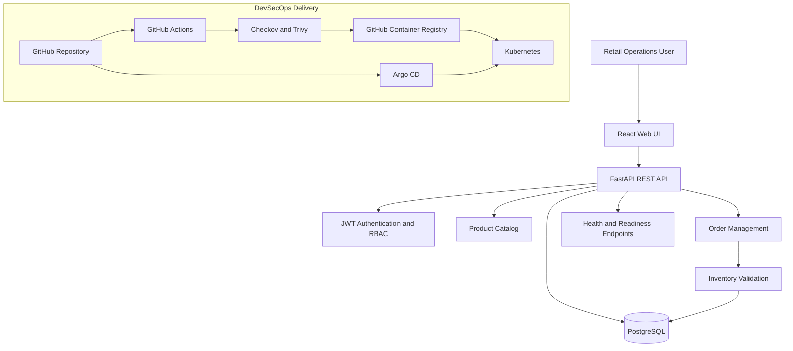
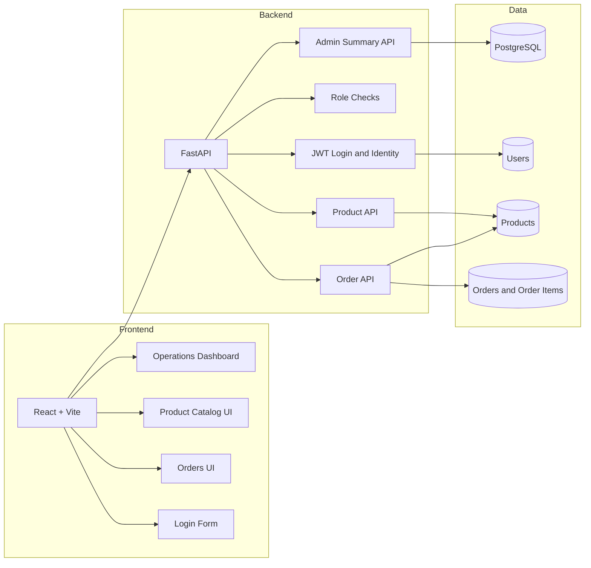
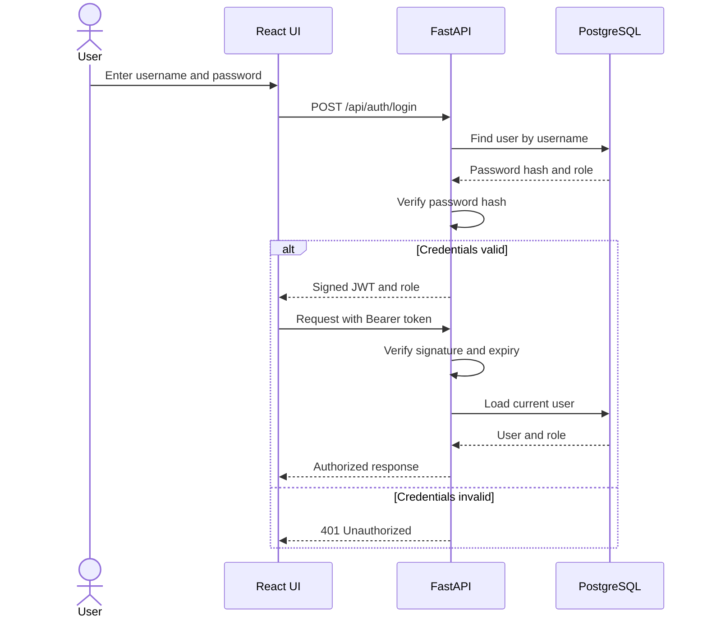
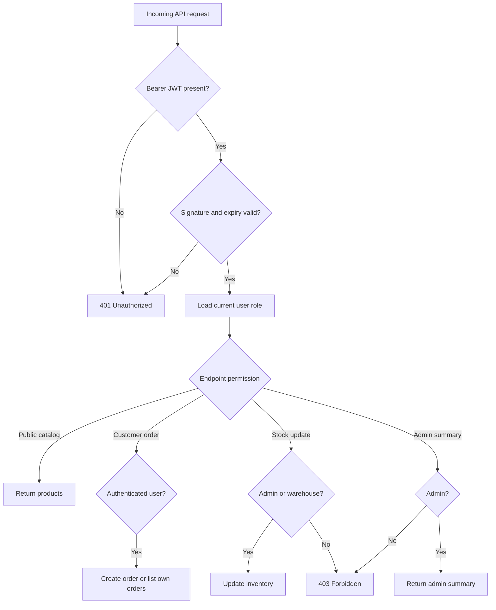
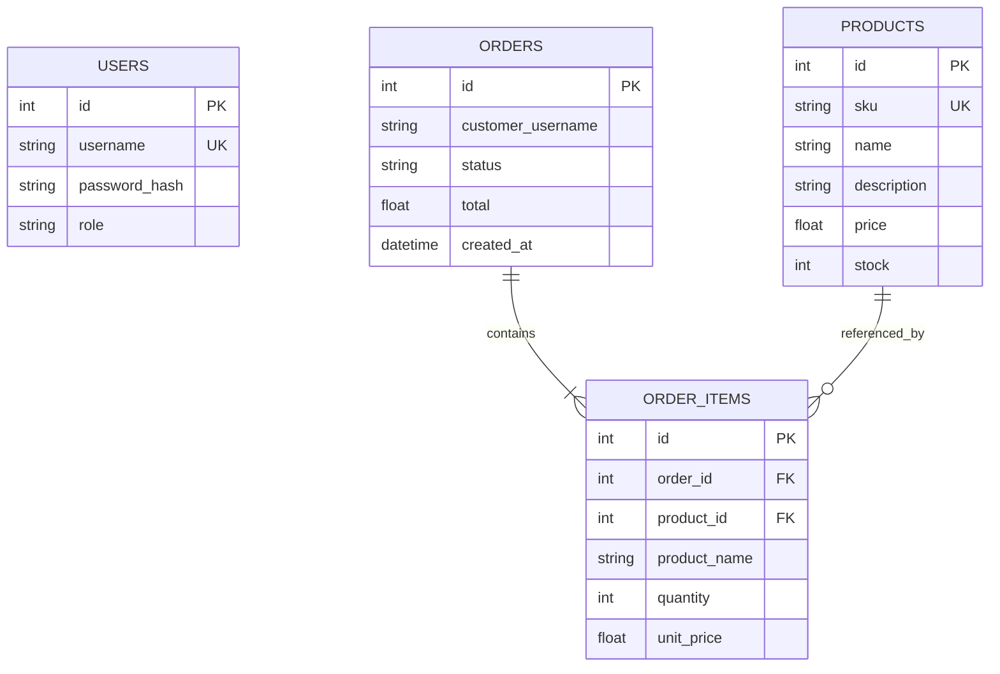

# Lab 7.1 — Five Mermaid Diagrams

All diagrams are self-contained teaching visuals for this stage. Some show the complete platform context.

## 1. End-to-End RetailOps Architecture

## 2. RetailOps Application Components

## 3. JWT Authentication Sequence

## 4. Role-Based Access Control

## 5. Database Entity Relationship

