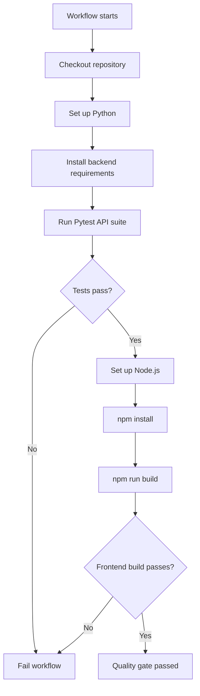
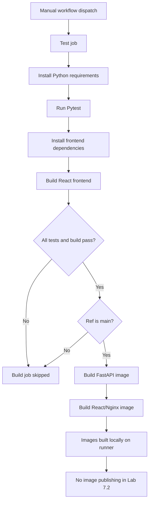
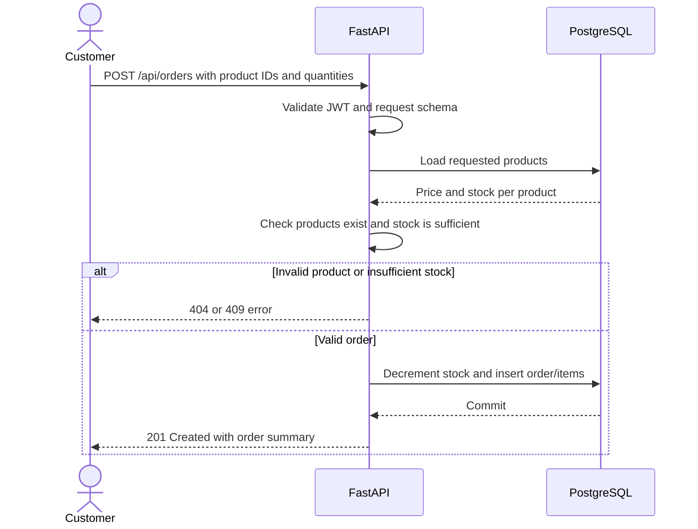
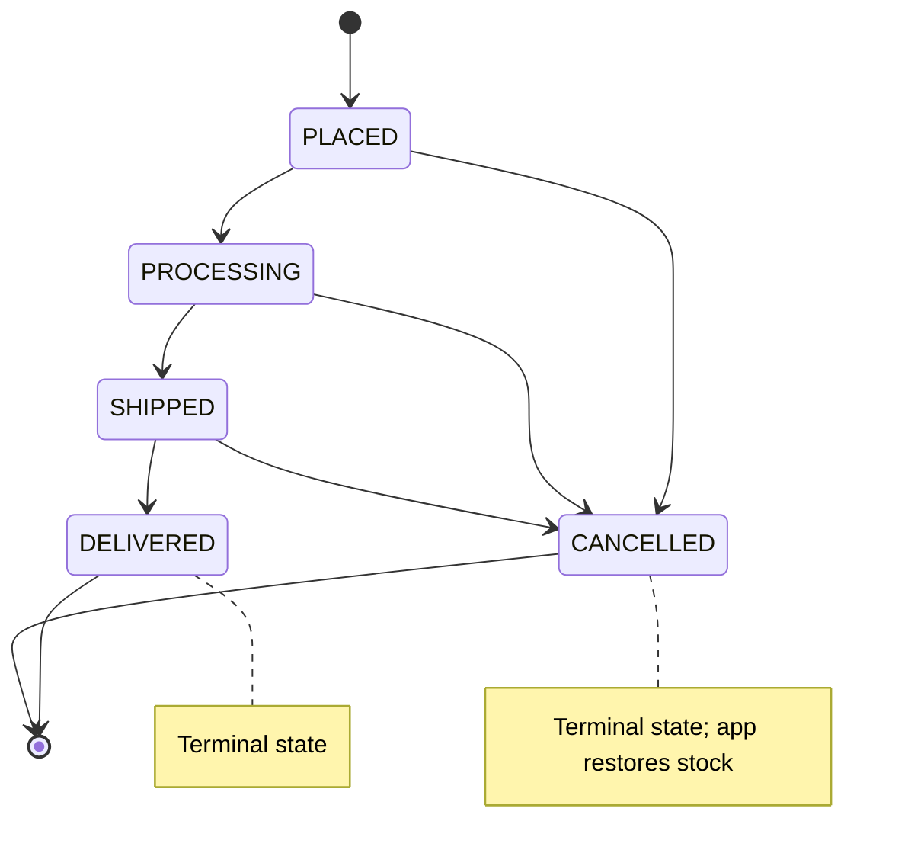
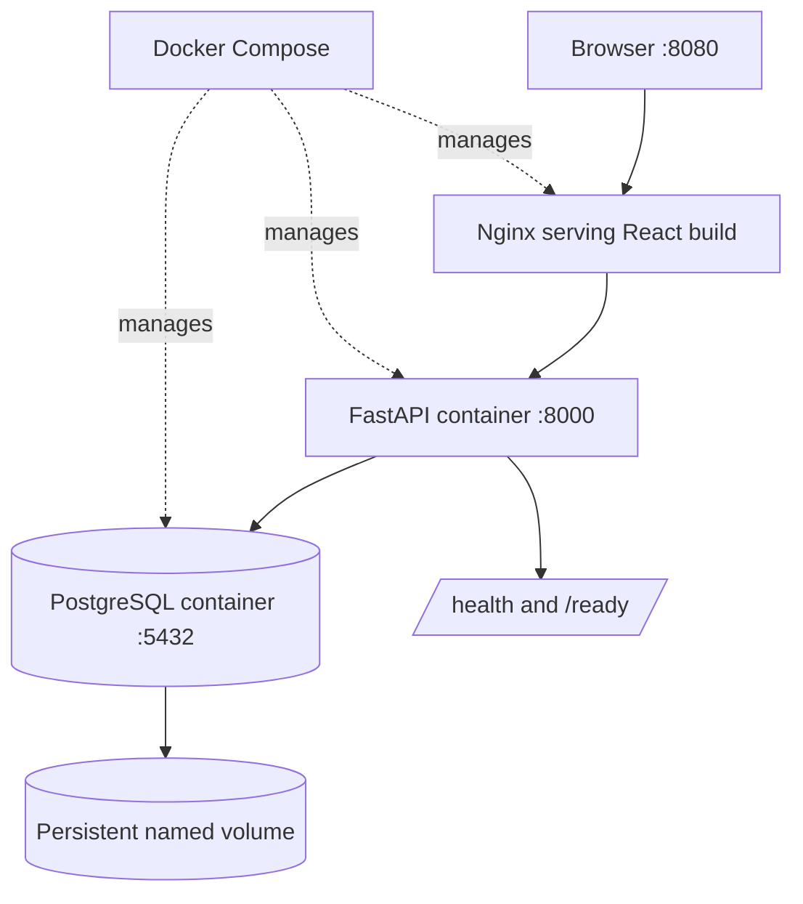

# Lab 7.2 — Five Mermaid Diagrams

All diagrams are self-contained teaching visuals for this stage. Some show the complete platform context.

## 1. Lab 7.1 Quality Gate

## 2. Lab 7.2 Docker Build Gate

## 3. Order Placement and Inventory Update

## 4. Order Status Lifecycle

## 5. Docker Compose Local Runtime

