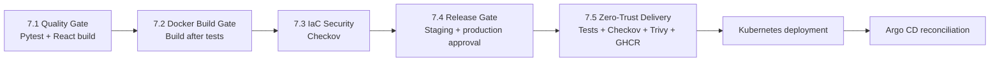
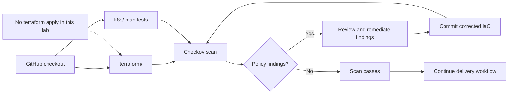
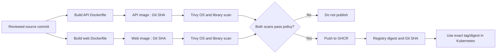
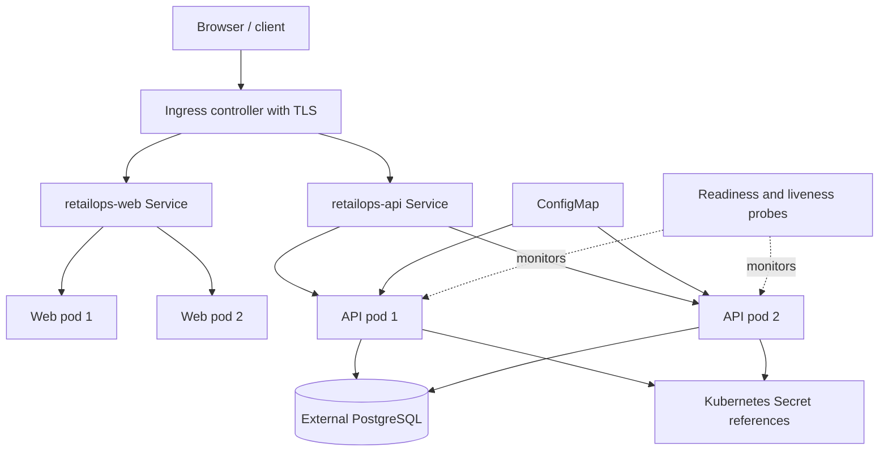
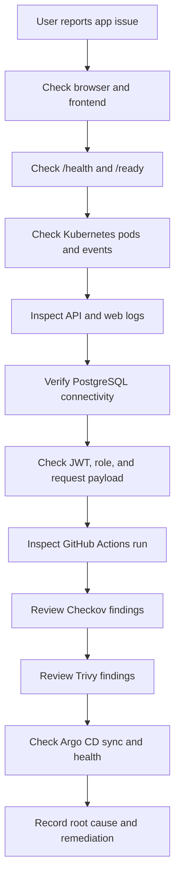

# Lab 7.3 — Five Mermaid Diagrams

All diagrams are self-contained teaching visuals for this stage. Some show the complete platform context.

## 1. Five-Stage Lab Roadmap

## 2. Lab 7.3 Infrastructure-as-Code Scan

## 3. Container Image Supply Chain

## 4. Kubernetes Runtime Architecture

## 5. Observability and Troubleshooting Path

