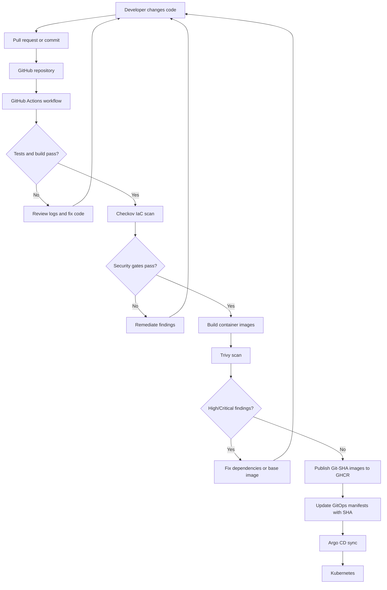
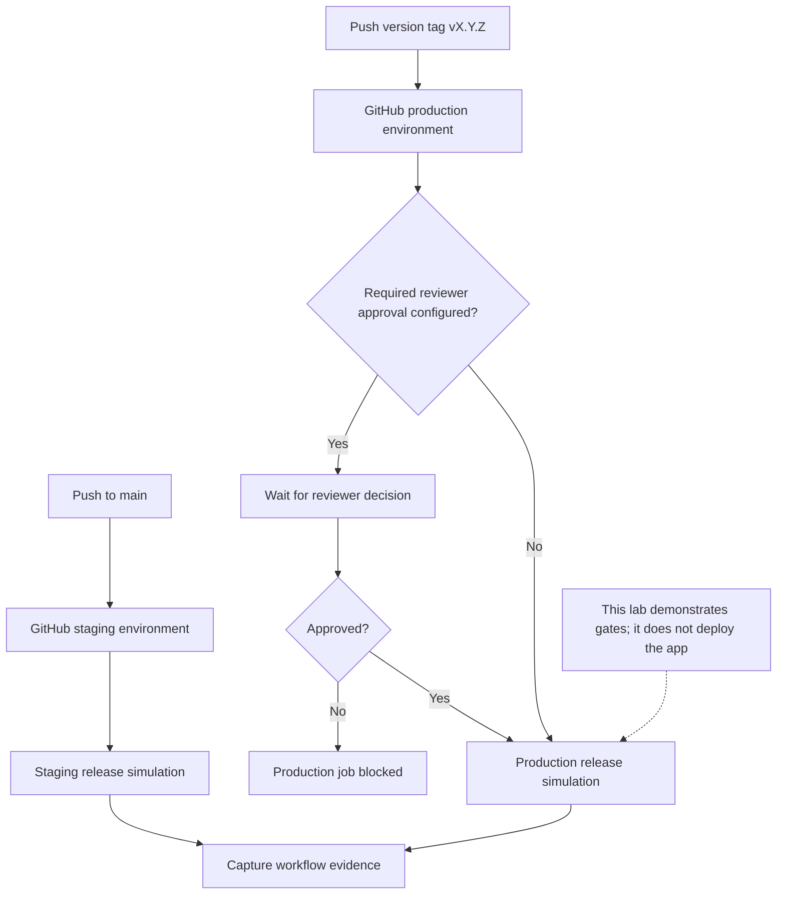
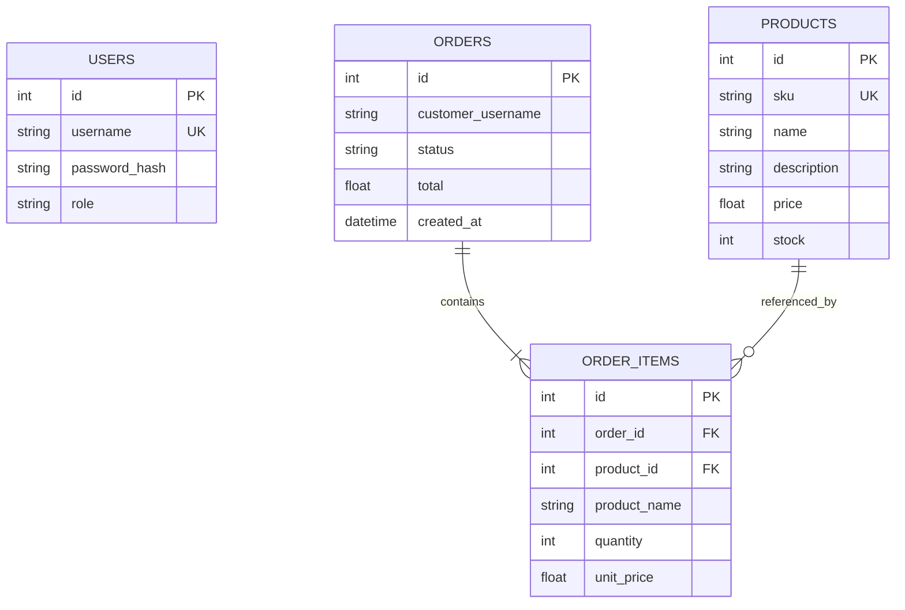
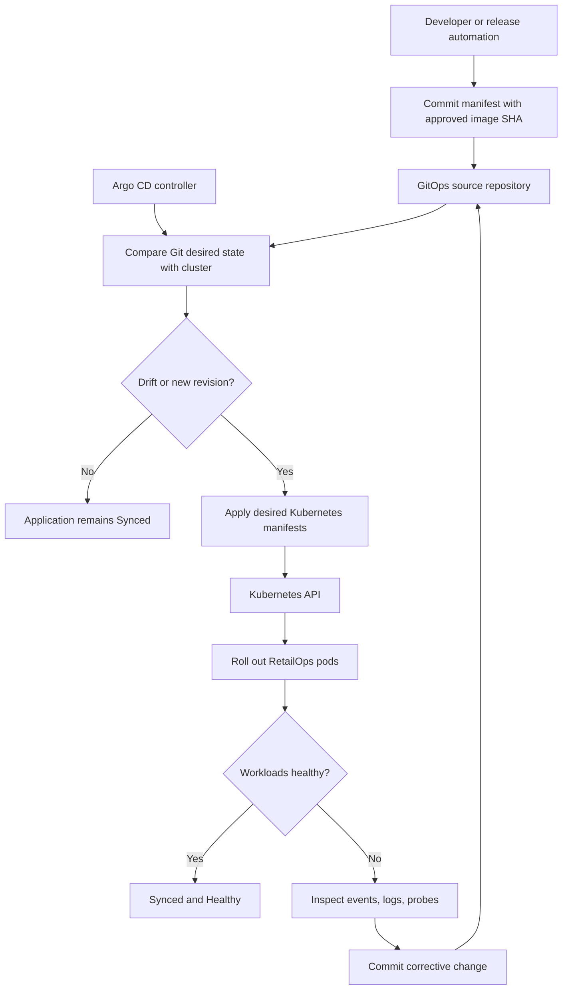
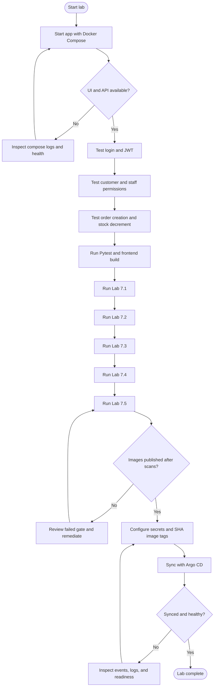

# Lab 7.4 — Five Mermaid Diagrams

All diagrams are self-contained teaching visuals for this stage. Some show the complete platform context.

## 1. Developer-to-Production Flow

## 2. Lab 7.4 Environment-Based Release Gate

## 3. Database Entity Relationship

## 4. Argo CD GitOps Reconciliation

## 5. End-to-End Student Validation Checklist

