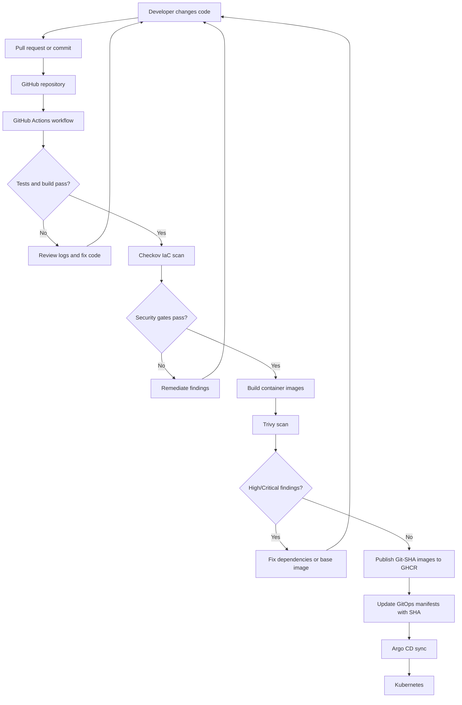
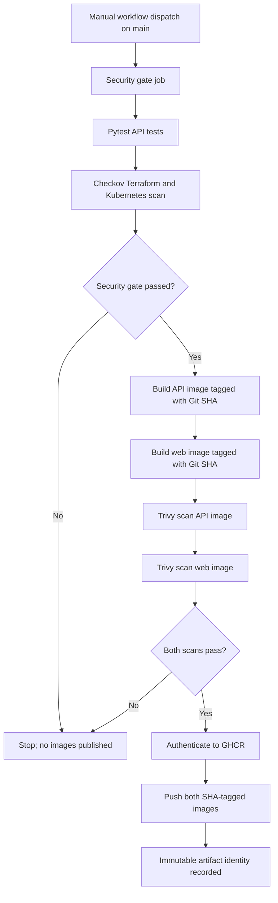
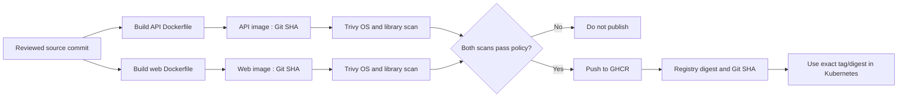
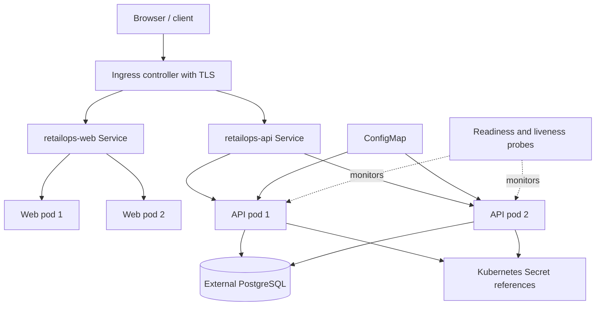
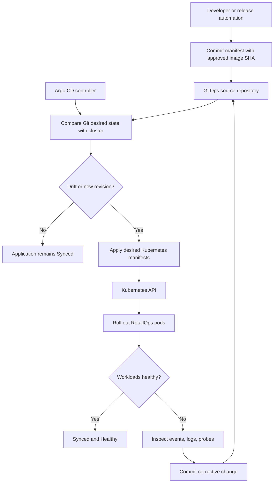

# Lab 7.5 — Five Mermaid Diagrams

All diagrams are self-contained teaching visuals for this stage. Some show the complete platform context.

## 1. Developer-to-Production Flow

## 2. Lab 7.5 Zero-Trust Delivery Pipeline

## 3. Container Image Supply Chain

## 4. Kubernetes Runtime Architecture

## 5. Argo CD GitOps Reconciliation

